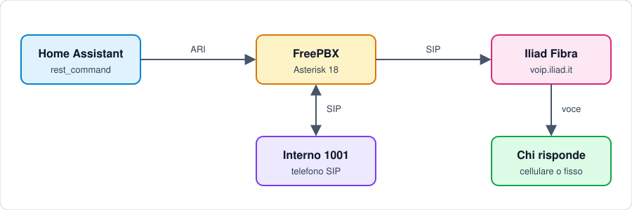

# FreePBX + Iliad + Home Assistant

Guida per usare la linea fissa **Iliad Fibra** con **FreePBX** (Asterisk) e far partire telefonate da **Home Assistant**, usando il numero di casa anche come normale telefono.

La guida parte da una configurazione funzionante con FreePBX 16 (Asterisk 18) e Iliad Fibra.

## Cosa si ottiene

- Chiamate in uscita e in entrata dal numero fisso di casa, con un interno SIP (telefono o softphone).
- Telefonate automatiche da Home Assistant verso qualsiasi numero, con un messaggio vocale alla risposta (per esempio un allarme).

## Schema

Home Assistant si registra su FreePBX come un interno (con l'integrazione [hass-sip](https://github.com/eigger/hass-sip)) e, quando un'automazione lo chiede, FreePBX apre la chiamata verso Iliad. Gli interni di casa usano lo stesso FreePBX per telefonare e ricevere.

## Cosa serve

- Iliad Fibra con la linea fissa attiva e i suoi dati VoIP (numero, password, server).
- Un server FreePBX 16 nella stessa rete di Home Assistant (VM o mini PC), con accesso SSH.
- Home Assistant con HACS (per installare l'integrazione hass-sip).
- Un telefono SIP o un softphone, per esempio Linphone, Zoiper o Telephone su Mac.
- Circa due ore di lavoro.

## Indice

1. [Recupera i dati SIP della linea Iliad](docs/01-dati-sip-iliad.md)
2. [Crea il trunk Iliad in FreePBX](docs/02-trunk-freepbx.md)
3. [Rotta in uscita](docs/03-rotta-in-uscita.md)
4. [Rotta in entrata](docs/04-rotta-in-entrata.md)
5. [Crea l'interno](docs/05-interno.md)
6. [Collega Home Assistant (hass-sip)](docs/06-home-assistant.md)
7. [Alternativa: chiamare con l'ARI di Asterisk](docs/07-alternativa-ari.md)

Inoltre:

- [Problemi comuni](docs/problemi-comuni.md)
- [Idee per sviluppare il progetto](docs/idee.md)
- [Esempi di configurazione pronti da copiare](examples/)

## Avvertenze

- Il passo 6 (hass-sip) è stato provato con una chiamata di prova verso un cellulare. Prima di affidargli un allarme verifica tu stesso la catena completa: automazione, chiamata, audio.
- I nomi delle voci nella GUI di FreePBX e nell'area personale Iliad possono cambiare con gli aggiornamenti.
- Non aprire mai la porta 5060 del router verso internet: un FreePBX con SIP esposto viene attaccato in pochi minuti.
- Non pubblicare mai numero, password o indirizzi IP reali: negli esempi sono tutti segnaposto.
